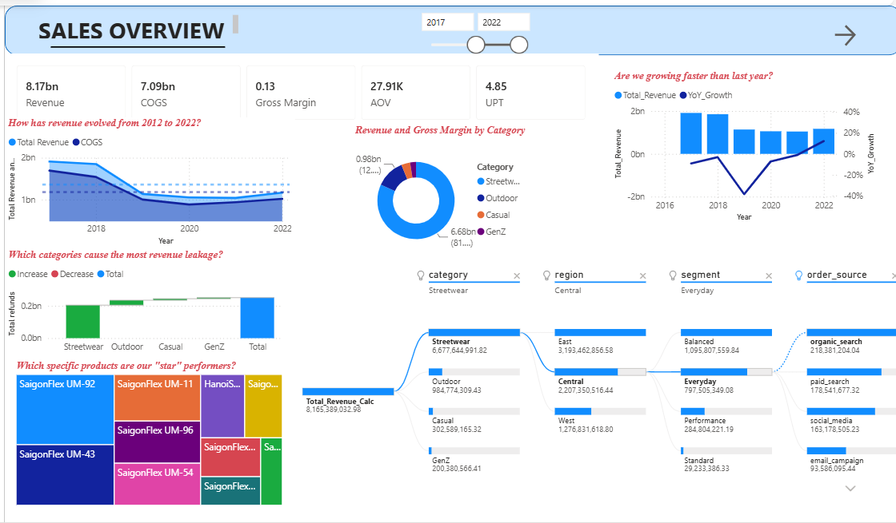
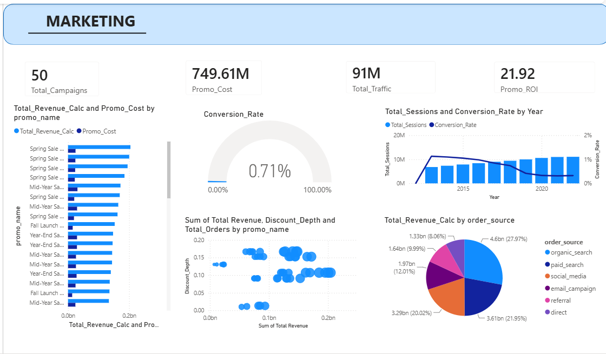
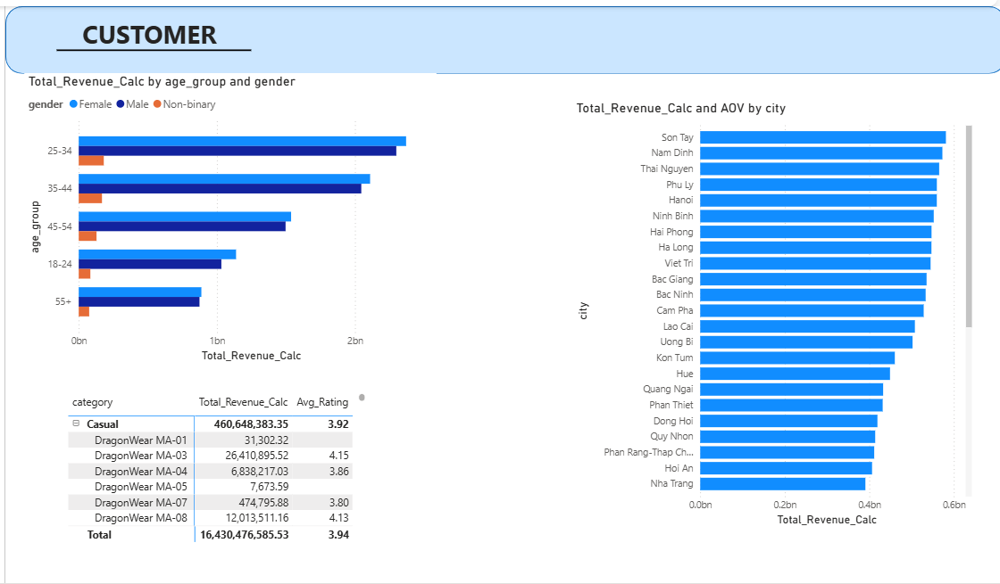
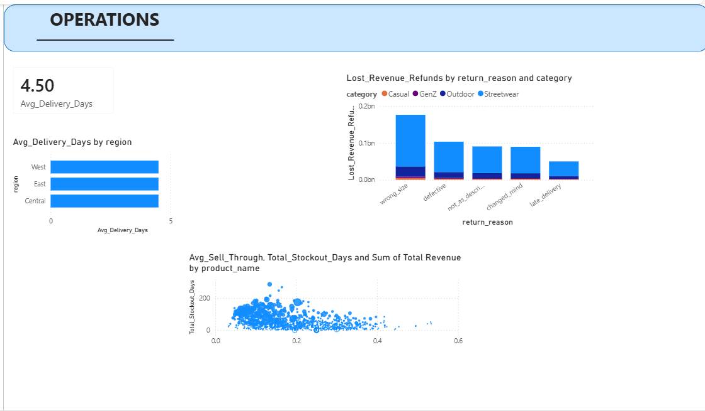
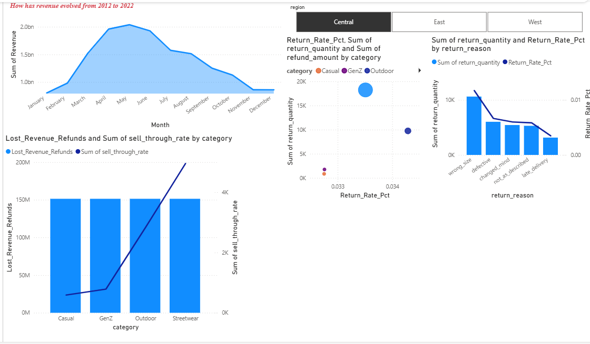

# Phân tích & dự báo doanh thu thương mại điện tử thời trang

Dashboard Power BI 5 trang trên dữ liệu giao dịch 10 năm (2012–2022) của một nhà bán lẻ thời trang trực tuyến, kèm pipeline dự báo doanh thu bằng Python.

**Vai trò:** Data Analyst · **Thời gian:** 01/2026 – 02/2026 · **Công cụ:** Power BI, Python (pandas, LightGBM, XGBoost), SQL

---

## Bài toán

Doanh thu giảm liên tục từ 2018 nhưng đội kinh doanh không chỉ ra được nguyên nhân nằm ở đâu: giá, danh mục sản phẩm, kênh thu hút hay khâu vận hành. Dashboard này được dựng để trả lời bốn câu hỏi theo thứ tự, mỗi trang một câu, thay vì gom tất cả chỉ số vào một màn hình.

## Dữ liệu

| Hạng mục | Giá trị |
|---|---|
| Khoảng thời gian | 2012 – 2022 |
| Số dòng giao dịch | ~714.000 |
| Chiều phân tích | Danh mục, vùng, phân khúc khách hàng, nguồn đơn hàng, chiến dịch, sản phẩm |
| Chỉ số tính thêm bằng DAX | Total_Revenue_Calc, Lost_Revenue_Refunds, Return_Rate_Pct, Avg_Sell_Through, Promo_ROI |

---

## Trang 1 — Sales Overview: doanh thu đang rò rỉ ở đâu

Doanh thu 8,17 tỷ, COGS 7,09 tỷ, biên gộp 0,13, AOV 27,91K, UPT 4,85.

Ba điều trang này cho thấy:

- Doanh thu rơi mạnh trong giai đoạn 2018–2020 rồi đi ngang, trong khi COGS gần như không giảm theo — biên gộp bị bóp từ hai phía.
- Danh mục **Streetwear chiếm 81% doanh thu** (6,68 tỷ). Mức tập trung này vừa là điểm mạnh vừa là rủi ro: mọi biến động của một danh mục kéo theo cả công ty.
- Biểu đồ thác nước chỉ ra Streetwear cũng là nơi thất thoát doanh thu do hoàn hàng lớn nhất, nghĩa là danh mục chủ lực đang vừa tạo doanh thu vừa tạo tổn thất.

## Trang 2 — Marketing: tiền chi đi đâu và đổi lại được gì

50 chiến dịch, chi phí khuyến mãi 749,61 triệu, tổng lượt truy cập 91 triệu, ROI khuyến mãi 21,92.

- **Tỷ lệ chuyển đổi chỉ 0,71%.** Lượt truy cập tăng đều qua các năm nhưng đường chuyển đổi đi xuống — vấn đề nằm ở chất lượng lưu lượng hoặc trải nghiệm sau khi khách vào, không phải ở lượng truy cập.
- Nhóm đơn hàng theo nguồn: organic_search 4,6 tỷ (27,97%), paid_search 3,61 tỷ (21,95%), social_media 3,29 tỷ (20,02%), email_campaign 1,97 tỷ (12,01%), referral 1,64 tỷ (9,99%), direct 1,33 tỷ (8,06%). Kênh tự nhiên vẫn gánh phần lớn doanh thu dù ngân sách đổ vào kênh trả phí.
- Biểu đồ phân tán giữa độ sâu giảm giá và doanh thu cho thấy giảm giá sâu hơn không đi kèm doanh thu cao hơn.

## Trang 3 — Customer: ai đang mua

- Nhóm **25–34 tuổi đóng góp doanh thu lớn nhất**, theo sau là 35–44. Nhóm 18–24 và 55+ đóng góp thấp hơn hẳn.
- Doanh thu theo thành phố phân bố khá đều, không có thị trường nào áp đảo — nghĩa là tăng trưởng không thể trông chờ vào việc mở rộng một vùng.
- Điểm đánh giá trung bình 3,94 trên 5. Bảng chi tiết theo sản phẩm cho thấy một số mã có doanh thu cao nhưng điểm đánh giá dưới trung bình, đây là nhóm cần soi trước khi nhập thêm hàng.

## Trang 4 — Operations: tổn thất nằm ở khâu nào

Thời gian giao hàng trung bình 4,50 ngày, đồng đều giữa ba vùng.

- **Sai kích cỡ là lý do hoàn hàng lớn nhất**, vượt xa hàng lỗi, không giống mô tả, đổi ý và giao chậm cộng lại trong nhóm Streetwear.
- Biểu đồ phân tán giữa tỷ lệ bán hết hàng và số ngày hết hàng cho thấy phần lớn sản phẩm nằm ở vùng bán chậm nhưng vẫn tồn kho lâu — vốn đọng ở nhóm sản phẩm không sinh lời.

## Trang 5 — Điểm nghẽn: chốt lại nguyên nhân

- Doanh thu có mùa vụ rõ rệt, đỉnh vào tháng 5 rồi giảm liên tục tới cuối năm. Lịch chiến dịch hiện tại không bám theo đường này.
- Lọc theo vùng cho thấy tỷ lệ hoàn hàng và lý do hoàn hàng gần như giống nhau ở cả ba vùng — vấn đề thuộc về sản phẩm và bảng quy đổi kích cỡ, không phải do vận hành của một vùng nào.

---

## Kết luận và đề xuất

| Phát hiện | Đề xuất |
|---|---|
| Sai kích cỡ là lý do hoàn hàng lớn nhất, tập trung ở danh mục chủ lực | Chuẩn hoá bảng quy đổi kích cỡ và bổ sung ảnh người mẫu kèm số đo thật cho nhóm Streetwear trước mùa cao điểm |
| Tỷ lệ chuyển đổi 0,71% trong khi lưu lượng vẫn tăng | Ngừng tối ưu theo lượt truy cập, chuyển chỉ tiêu marketing sang doanh thu trên mỗi phiên |
| Giảm giá sâu không kéo doanh thu lên tương ứng | Giới hạn độ sâu giảm giá, chuyển ngân sách sang kênh tự nhiên và email vốn có ROI tốt hơn |
| 81% doanh thu đến từ một danh mục | Đặt chỉ tiêu tăng tỷ trọng doanh thu ngoài Streetwear, theo dõi hằng quý |

## Dự báo doanh thu

Ngoài dashboard, dự án có một pipeline dự báo doanh thu theo chuỗi thời gian:

- Đặc trưng theo độ trễ, trung bình trượt và biến mùa vụ theo tháng.
- Mô hình LightGBM và XGBoost, so sánh với đường cơ sở naive.
- Kiểm định walk-forward theo thời gian để tránh rò rỉ dữ liệu từ tương lai về quá khứ — chia ngẫu nhiên sẽ cho kết quả đẹp giả tạo trên dữ liệu chuỗi thời gian.

---

*Ảnh chụp từ báo cáo Power BI của chính dự án. Dữ liệu là bộ dữ liệu dùng cho mục đích học tập và phân tích, không chứa thông tin của khách hàng thật.*
