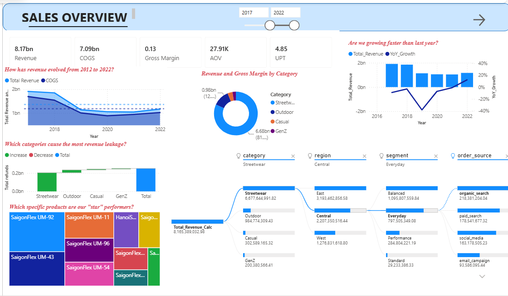

# Data Analytics Portfolio — Nguyễn Hương Giang

Phân tích dữ liệu sản phẩm và kinh doanh. Mỗi thư mục là một dự án, có đầy đủ bối cảnh bài toán, dữ liệu, cách làm, ảnh chụp dashboard và kết luận.

**Liên hệ:** giangnguyenhuong20051510@gmail.com · [LinkedIn](https://www.linkedin.com/in/nguyễn-giang200859382/)

---

## Về tôi

Sinh viên năm cuối Kinh tế Quốc tế, Đại học Ngoại thương, nền tảng thống kê và kinh tế lượng. Sáu tháng phân tích dữ liệu sản phẩm cho 14 ứng dụng di động iOS và Android phục vụ hàng triệu người dùng mỗi ngày: truy xuất dữ liệu hành vi bằng SQL, theo dõi bộ chỉ số sản phẩm, dựng dashboard định kỳ và phát hiện lỗi ghi nhận dữ liệu trước mỗi bản phát hành.

**Công cụ:** SQL · Python (pandas, LightGBM, XGBoost) · Power BI · Excel nâng cao · Firebase · Adjust

---

## Dự án

### 1. [Phân tích & dự báo doanh thu thương mại điện tử thời trang](01-ecommerce-fashion-powerbi/)

Dashboard Power BI 5 trang trên 714 nghìn dòng giao dịch trong 10 năm, truy nguyên nhân doanh thu giảm về từng khâu: danh mục, kênh thu hút, khách hàng và vận hành. Kèm pipeline dự báo doanh thu theo chuỗi thời gian có kiểm định walk-forward.

Phát hiện chính: sai kích cỡ là lý do hoàn hàng lớn nhất và tập trung ở danh mục chiếm 81% doanh thu; tỷ lệ chuyển đổi chỉ 0,71% trong khi lưu lượng vẫn tăng đều.

`Power BI` `DAX` `Python` `Time series`

---

### 2. [Báo cáo tình hình cấp tín dụng — Ngân hàng TMCP VNC](02-credit-risk-analysis/)

Bộ 5 stored procedure trên SQL Server tự động hoá báo cáo tín dụng định kỳ: quy mô dư nợ, thu hồi nợ theo quý, lãi suất bình quân và phân bổ theo mạng lưới chi nhánh. Nhận tham số ngày đầu kỳ và cuối kỳ nên chạy lại được cho bất kỳ kỳ báo cáo nào.

Phát hiện chính: 5 khách hàng lớn nhất chiếm gần 45% tổng giá trị giải ngân mới trong kỳ; hạn mức ký mới 324 tỷ nhưng dư nợ gốc thực tế chỉ tăng 52 tỷ.

`SQL Server` `Stored procedure` `CTE` `Window function` `Financial analysis`

---

## Cách đọc repo này

Mỗi dự án có một `README.md` riêng viết theo cùng một mạch: bài toán cần trả lời → dữ liệu dùng → cách làm → kết luận và đề xuất. Mã nguồn nằm trong thư mục `sql/` hoặc `notebooks/`, dữ liệu kết quả trong `data/`, ảnh chụp trong `images/` của dự án đó.
